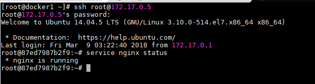

> **Cập nhật (2026):** ví dụ dùng `ubuntu:14.04` và `MAINTAINER` (cả hai đã cũ), khi thực hành hãy đổi sang `ubuntu:24.04` và `LABEL maintainer=...`. Về mặt thiết kế: Docker khuyến nghị **mỗi container một tiến trình chính**; chạy nhiều tiến trình trong một container bằng `supervisor` (ssh + apache + nginx như bài) chỉ nên dùng khi thật sự cần, ví dụ ứng dụng cũ khó tách. Với ứng dụng mới, hãy tách thành nhiều container và nối bằng Compose. Cần thao tác vào container thì dùng `docker exec -it` thay vì chạy SSH trong container. Nếu cần một "init" nhẹ để dọn tiến trình con, dùng `docker run --init` hoặc `init: true` trong Compose.

## Hướng dẫn sử dụng supervisor để quản lý multi service trên container.

Thông thường, người dùng được khuyến cáo chạy riêng rẽ mỗi service trên từng container. Tuy nhiên, trong rất nhiều trường hợp, container có thể chạy đồng thời nhiều service trên một container. Điều này có thể gây ra khó khăn trong quá trình khởi tạo image với Dockerfile hay trong quá trình sử dụng service. 

Trong bài viết này, tôi sẽ hướng dẫn các bạn sử dụng chương trình **supervisor** để quản lý việc sử dụng các service chạy chung trên 1 container.

 - Supervisor là một công cụ kiểm soát và giám sát tiến trình dùng để kiểm soát nhiều process trên UNIX OS.
 
Để thực hiện việc này, sẽ cần 2 bước sau :
	
 - Dockerfile sẽ chạy Supervisor trên foreground
 - supervisor.conf file được đẩy vào Dockerfile, dùng để khai báo multiple process sẽ được chạy bên trong Docker container.
 
Trong bài lab này sẽ chạy 2 process là SSH và nginx trên cùng 1 container và dùng supervisor để quản lý 2 tiến trình này :

**Dockerfile** :

```sh
FROM ubuntu:14.04
MAINTAINER sharad &lt;sharad.aggarwal@tothenew.com&gt;
RUN apt-get update &amp;&amp; apt-get install -y openssh-server apache2 supervisor nginx
RUN mkdir -p /var/lock/apache2 /var/run/apache2 /var/run/sshd /var/log/supervisor
RUN echo 'root:password' | chpasswd
RUN sed -i 's/PermitRootLogin without-password/PermitRootLogin yes/' /etc/ssh/sshd_config
COPY supervisord.conf /etc/supervisor/conf.d/supervisord.conf
EXPOSE 22 80 443
CMD ["/usr/bin/supervisord"]
```

**supervisord.conf**
```sh
[supervisord]
nodaemon=true
 
[program:sshd]
command=/usr/sbin/sshd -D
 
[program:nginx]
command=/usr/sbin/nginx -g "daemon off;"
priority=900
stdout_logfile= /dev/stdout
stdout_logfile_maxbytes=0
stderr_logfile=/dev/stderr
stderr_logfile_maxbytes=0
username=www-data
autorestart=true
```

 - Build images file
```sh
docker build -t manhdv/supervisor-nginx-ssh .
```

 - launch container từ image 
```sh
docker run -itd --name nginx-ssh-test manhdv/supervisor-nginx-ssh
```
 - Login vào container để kiểm tra IP :
```sh
docker exec -it $container_id bash
```
 - SSH vào container và kiểm tra dịch vụ 
 
Kết quả như sau : 

